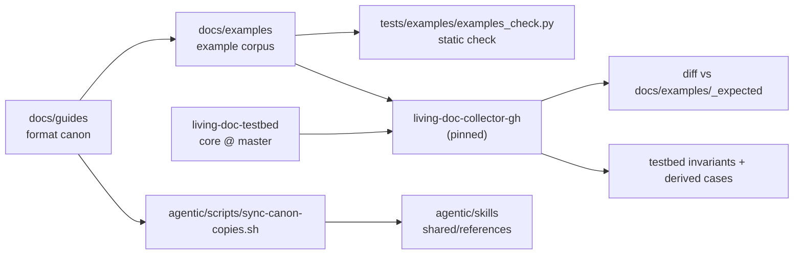

# living-doc

## Purpose

Entry point of the Living Documentation ecosystem. Holds the concept, architecture and format docs for people, the canonical example corpus the collectors mine, the checks that run the pinned `living-doc-collector-gh` over it, and the optional AI authoring layer `agentic/`.

Not here: the collectors, toolkit, generators and utilities. Each lives in its own `AbsaOSS/living-doc-*` repository ([README.md § Projects](README.md#projects)).

## Tech stack

- Markdown: most changes are prose under `docs/`.
- Python: standalone scripts under `tests/` and `agentic/`. No package, no `pyproject.toml`, no `Makefile`, no lint, type-check or coverage gate.
- Bash: the runners `tests/**/*.sh` and `agentic/scripts/*.sh`.
- GitHub Actions, Python 3.14; the agentic script tests also run on 3.10.
- Pinned externals: `living-doc-collector-gh` (`tests/collector/collector-pins.env`), `living-doc-utilities` (`tests/examples/requirements-examples-check.txt`). Read unpinned: `AbsaOSS/living-doc-testbed` at `master`.

## Structure

| Path | Holds | Context |
|---|---|---|
| `docs/` | people docs, the format canon, the example corpus and its snapshots, integration gate reports | [docs/CONTEXT.md](docs/CONTEXT.md) |
| `tests/` | the corpus checker and the two collector stages | [tests/CONTEXT.md](tests/CONTEXT.md) |
| `agentic/` | the shipped AI authoring layer: skills, one agent, evals, eval scripts | [agentic/CONTEXT.md](agentic/CONTEXT.md) |
| `.github/` | CI workflows, PR and issue templates | [.github/CONTEXT.md](.github/CONTEXT.md) |
| `.claude/` | this repository's own dev agents and skills: the agd kit (listed in `.agd.lock`) plus the project agent `agents/eval-runner.md` | none |
| `.local_context/` | private task notes and plans; only its README and `.gitignore` are tracked | [README](.local_context/README.md) |
| `specs/` | local planning, gitignored | none |

## How it fits together

The guides define the format; the corpus shows it; the checks prove the corpus follows the guides and that the real collector mines it as expected. The agentic layer reads generated copies of two canon pages.

## Domain

- Entities: User Story, Feature, Functionality, Acceptance Criterion (AC): [glossary](docs/guides/living-doc-glossary.md), header formats in [header types](docs/guides/living-doc-header-types.md).
- Document types: technical project (inner and release views), test catalog, coverage matrix: [document types](docs/guides/living-doc-document-types.md).
- Pipeline: author, collector, toolkit, generator: [architecture](docs/introduction/architecture.md).

## Contracts

| Contract | Canon | Enforced by |
|---|---|---|
| Entity headers, AC grammar `AC:<id> (v<version> - <state>)`, scenario tag `@AC:<id>[/<param>:<value>]` | `docs/guides/living-doc-header-types.md`, `docs/guides/living-doc-glossary.md` | `tests/examples/examples_check.py`, the corpus sync obligation, the generated copies in `agentic/` |
| Document types | `docs/guides/living-doc-document-types.md` | review |
| Ecosystem frame F1–F7 and its exceptions | `docs/introduction/principles.md` | the PR template's `## Framework` box, review |
| Collector output | owned by `living-doc-utilities`; snapshots in `docs/examples/_expected/` | the diff in `real-collector.yml` |

## Running it

Commands: `AGENTS.md` § This project. The collector stages need `git` and github.com access, no token; they build a venv in `.snapshot-venvs/` (gitignored).

## Conventions

- Every PR stays inside the frame in `docs/introduction/principles.md`, or names the row it bends and adds the exception there in the same PR.
- Same-PR obligations: a format change in a guide updates `docs/examples/`; a canon change regenerates the agentic copies; a collector pin bump regenerates `docs/examples/_expected/` and keeps the testbed stage green.
- Docs link, they don't copy. Lychee checks every link and fragment in every `*.md`.
- Nothing from `specs/` is committed or cited: it is local planning.
- PR, branch, title and review rules: `AGENTS.md` § This project.

## Key decisions

- The pipeline is AI-free; AI exists only in authoring (`agentic/`). Every checker here is deterministic and offline (principles F6).
- No lint, type-check or coverage gate, because the Python is a few standalone scripts with no package.
- Planning docs stay local and gitignored, so tracked docs carry everything normative.

## Invariants and gotchas

- High-risk: the three format guides, the rule set in `tests/examples/examples_check.py`, the snapshot pipeline (`tests/examples/regen-collector-snapshots.sh`, `normalize_snapshot.py`, `check_collector_stage.py`), the shared collector run and testbed stage (`tests/collector/`, `tests/testbed/`), the pin in `tests/collector/collector-pins.env`.
- Generated, never hand-edited: `docs/examples/_expected/**` and `agentic/skills/shared/references/{living-doc-glossary,living-doc-bdd-schemas}.md`. A diff there means its source changed; regenerate it.
- The repository is public: `docs/_integration/` commits only redacted rows for internal targets.
- `agentic/` tests are scripts, not pytest tests: a bare `pytest` there collects nothing and passes.
