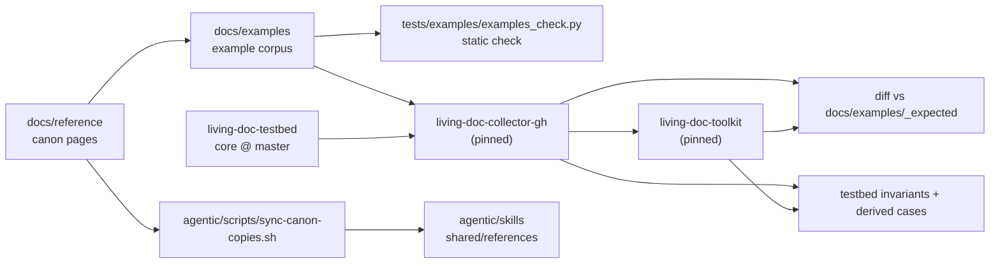

# living-doc

## Purpose

Entry point of the Living Documentation ecosystem. Holds the concept, architecture and format docs for people, the canonical example corpus the collectors mine, the checks that run the pinned `living-doc-collector-gh` and `living-doc-toolkit` over it, the local integration runner that runs the whole source-code chain on an operator's machine for a milestone, and the optional AI authoring layer `agentic/`.

Not here: the collectors, toolkit, generators and utilities. Each lives in its own `AbsaOSS/living-doc-*` repository ([README.md § Projects](README.md#projects)).

## Tech stack

- Markdown: most changes are prose under `docs/`.
- Python: standalone scripts under `tests/` and `agentic/`. No package, no `pyproject.toml`, no `Makefile`, no lint, type-check or coverage gate.
- Bash: the runners `tests/**/*.sh` and `agentic/scripts/*.sh`.
- GitHub Actions, Python 3.14; the agentic script tests also run on 3.10.
- Pinned externals: `living-doc-collector-gh`, `living-doc-toolkit` and `living-doc-generator-markdown` (`tests/collector/collector-pins.env`), `living-doc-utilities` (`tests/examples/requirements-examples-check.txt`). Read unpinned: `AbsaOSS/living-doc-testbed` at `master`.

## Structure

| Path | Holds | Context |
|---|---|---|
| `docs/` | people docs, the format canon, the example corpus and its snapshots, integration gate and milestone reports | [docs/CONTEXT.md](docs/CONTEXT.md) |
| `tests/` | the corpus checker (with the authoring guide's pairs and the error codes), the two collector stages, the retired-names check, the local integration runner `tests/integration/local-integration.sh` | [tests/CONTEXT.md](tests/CONTEXT.md) |
| `agentic/` | the shipped AI authoring layer: skills, one agent, evals, eval scripts | [agentic/CONTEXT.md](agentic/CONTEXT.md) |
| `.github/` | CI workflows, PR and issue templates | [.github/CONTEXT.md](.github/CONTEXT.md) |
| `.claude/` | this repository's own dev agents and skills: the agd kit (listed in `.agd.lock`) plus the project agent `agents/eval-runner.md` | none |
| `.local_context/` | private task notes and plans; only its README and `.gitignore` are tracked | [README](.local_context/README.md) |
| `specs/` | local planning, gitignored | none |

## How it fits together

The canon pages in `docs/reference/` define the format; the corpus shows it; the checks prove the corpus follows them and that the real collector and toolkit carry it through as expected. The agentic layer reads generated copies of two canon pages.

## Domain

- Entities: User Story, Feature, Functionality, Acceptance Criterion (AC): [glossary](docs/reference/glossary.md), header formats in [authoring formats](docs/reference/authoring-formats.md).
- Document types: technical project (inner and release views), test catalog, coverage matrix: [document types](docs/guides/living-doc-document-types.md); what each view shows and how coverage is counted: [rendering rules](docs/reference/rendering-rules.md).
- Authoring: the canonical form, the variants normalisation corrects and the mistakes it never guesses: [authoring documentation](docs/guides/authoring-documentation.md).
- Pipeline: author, collector, toolkit, generator: [architecture](docs/introduction/architecture.md); which component writes and reads each file: [data flows](docs/reference/data-flows.md); the six contracts: [contracts](docs/reference/contracts.md); every error and warning code with its remedy: [error codes](docs/reference/errors.md). These three summarise `living-doc-utilities` and the component pages, and are not canon.

## Contracts

| Contract | Canon | Enforced by |
|---|---|---|
| Entity headers, AC grammar `AC:<id> (v<version> - <state>)`, scenario tag `@AC:<id>[/<param>:<value>]` | `docs/reference/authoring-formats.md`, `docs/reference/glossary.md` | `tests/examples/examples_check.py`, the corpus sync obligation, the generated copies in `agentic/` |
| Document types and views | `docs/guides/living-doc-document-types.md`; `docs/reference/rendering-rules.md` explains the views, normative in `living-doc-utilities`, and defines *What was not loaded*, which `living-doc-utilities` only maps onto warning fields | review |
| Ecosystem frame F1–F7 and its exceptions | `docs/introduction/principles.md` | the PR template's `## Framework` box, review |
| Collector and toolkit output | owned by `living-doc-utilities`; snapshots in `docs/examples/_expected/` | the checks and the diff in `real-collector.yml` |
| Retired artifact, field and command names, here and in the pinned components | `living-doc-utilities` `docs/contracts.md` (R3, R8) | `tests/docs/retired_names_check.py --strict` in `retired-names.yml` |

## Running it

Commands: `AGENTS.md` § This project. The collector stages need `git` and github.com access, no token; they build one venv per component in `.snapshot-venvs/` (gitignored).

The local integration runner, `bash tests/integration/local-integration.sh [--check]`, is run by an operator for a milestone, never by CI or an agent's check: it needs github.com, PyPI and minutes. Its configuration is `tests/integration/.env.local` (git-ignored; copy `tests/integration/.env.local.example`). It clones into `out/` (git-ignored) and writes to `out/<run-id>/` unless `OUT_DIR` names a milestone folder under `docs/_integration/` ([docs/_integration/README.md § Run a milestone target](docs/_integration/README.md#run-a-milestone-target)).

## Conventions

- Every PR stays inside the frame in `docs/introduction/principles.md`, or names the row it bends and adds the exception there in the same PR.
- Same-PR obligations: a format change in a canon page updates `docs/examples/`, and a Project Profile or `seed.yaml` change in `agentic/skills/shared/references/agentic-formats.md` updates `docs/examples/project-profile/`; a canon change regenerates the agentic copies; a collector or toolkit pin bump regenerates `docs/examples/_expected/` and keeps the testbed stage green; a move of the checker's `living-doc-utilities` version brings the before/after pairs in `docs/guides/authoring-documentation.md` and the codes in `docs/reference/errors.md` in line with it, which `tests/examples/examples_check.py` checks ([CONTRIBUTING.md § Regenerating the collector snapshots](CONTRIBUTING.md#regenerating-the-collector-snapshots)).
- Docs link, they don't copy. Lychee checks every link and fragment in every `*.md`.
- Nothing from `specs/` is committed or cited: it is local planning.
- PR, branch, title and review rules: `AGENTS.md` § This project.

## Key decisions

- The pipeline is AI-free; AI exists only in authoring (`agentic/`). Every checker here is deterministic (principles F6) and reads the network only for pinned inputs ([tests/CONTEXT.md](tests/CONTEXT.md)).
- No lint, type-check or coverage gate, because the Python is a few standalone scripts with no package.
- Planning docs stay local and gitignored, so tracked docs carry everything normative.

## Invariants and gotchas

- High-risk: the canon pages in `docs/reference/` (glossary, authoring formats, rendering rules), the rule set in `tests/examples/examples_check.py`, the snapshot pipeline (`tests/examples/regen-collector-snapshots.sh`, `normalize_snapshot.py`, `check_collector_stage.py`, `check_toolkit_stage.py`), the shared collector and toolkit runs and testbed stage (`tests/collector/`, `tests/testbed/`), the pins in `tests/collector/collector-pins.env`.
- Generated, never hand-edited: `docs/examples/_expected/**` and `agentic/skills/shared/references/{living-doc-glossary,living-doc-bdd-schemas}.md`. A diff there means its source changed; regenerate it.
- The repository is public: `docs/_integration/` commits only redacted rows for internal targets.
- `agentic/` tests are scripts, not pytest tests: a bare `pytest` there collects nothing and passes.
