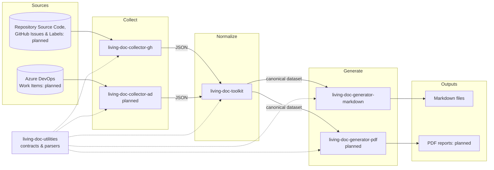
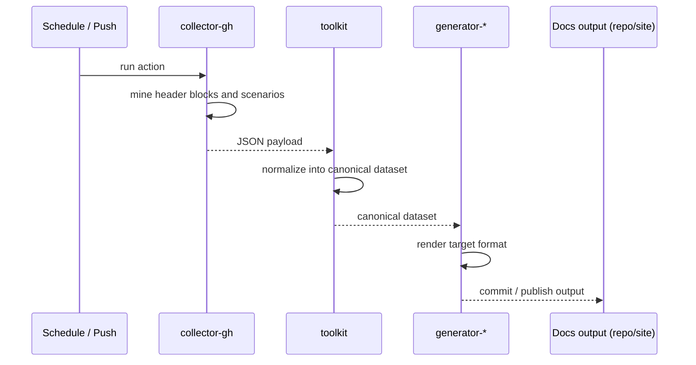

# Architecture

## Purpose

This page is the shape of the system: the three stages, the part each repository plays in them, and how one run flows.

Read before: [What is Living Documentation?](what-is-living-documentation.md) · Next: [Data flows](../reference/data-flows.md)

## Contents

- [Pipeline overview](#pipeline-overview)
- [Stage responsibilities](#stage-responsibilities)
- [Typical run (GitHub Action)](#typical-run-github-action)

## Pipeline overview

The ecosystem is split into three stages — **collect**, **normalize**, **generate** — connected by a shared JSON data shape defined in [living-doc-utilities](https://github.com/AbsaOSS/living-doc-utilities). Every project in the stack plugs into exactly one stage, which is what lets any collector feed any generator. Planned parts are marked in the diagram.

## Stage responsibilities

| Stage | Project(s) | Responsibility |
|---|---|---|
| Collect | `collector-gh`; `collector-ad` (planned) | Read one source system — source code today; issues, labels and work items are planned — and emit JSON. |
| Shared model | `utilities` | Define the contracts and the authoring-format parsers every other project imports, so collector output and generator input agree on shape. |
| Normalize | `toolkit` | Take the collector output of the project's one documentation source, and its tests, and produce the canonical file a generator reads. A pipeline never merges two documentation sources ([one documentation source per pipeline](https://github.com/AbsaOSS/living-doc-utilities/blob/master/docs/contracts/pipeline-rules.md#one-project-one-pipeline-one-documentation-source)). |
| Generate | `generator-markdown`; `generator-pdf` (planned) | Take the canonical dataset and render one target format. |

What each part must not do, and the deliberate exceptions, are fixed in [Principles](principles.md).

Which file each component writes and reads: [Data flows](../reference/data-flows.md). The six contracts between them:
[Contracts](../reference/contracts.md). What an error or warning code means and what to do: [Error codes](../reference/errors.md).

## Typical run (GitHub Action)

Each stage runs as an independent GitHub Action, so a pipeline is assembled by chaining actions in a workflow file — see [Build a pipeline](../guides/build-a-pipeline.md).
