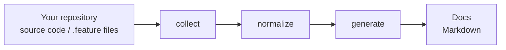

# Living Documentation in 5 Minutes

## Purpose

This page is the five-minute path: what a pipeline does, what to prepare for the document you want, and where to
build it.

Living Documentation generates your project docs **from what your repository already holds** —
header blocks in your source code and Gherkin `.feature` files — so they never go stale. GitHub
issues and Azure DevOps work items as sources are planned.

Read before: [What is Living Documentation?](what-is-living-documentation.md) · Next: [Build a pipeline](../guides/build-a-pipeline.md)

## Contents

- [The whole idea](#the-whole-idea)
- [Step 1 — Decide what you want to produce](#step-1--decide-what-you-want-to-produce)
- [Step 2 — Pick your two ends](#step-2--pick-your-two-ends)
- [Step 3 — Add one workflow file](#step-3--add-one-workflow-file)
- [Step 4 — Run it](#step-4--run-it)
- [Step 5 — Check the result](#step-5--check-the-result)
- [Go deeper](#go-deeper)

## The whole idea

Three stages, always in this order:

- **collect** — a *collector* pulls the header blocks and scenarios out of your source code as JSON
  (issues / work items are planned).
- **normalize** — the *toolkit* turns that JSON into one canonical shape (needed even with a single source).
- **generate** — a *generator* renders the canonical data as Markdown (PDF is planned).

Every stage is a separate GitHub Action. A pipeline is just those actions chained in one workflow
file. Full detail: [Architecture](architecture.md).

## Step 1 — Decide what you want to produce

This decides what you have to prepare for the collector to mine:

| You want a… | Prepare |
|---|---|
| **Technical project** — User Stories, Features, Functionalities | The entities as header blocks in source code (issues labelled as US / Feature / Functionality are planned) |
| **Test catalog** — the behaviours your tests cover | Gherkin `.feature` files in the repo |
| **Coverage matrix** — which acceptance criteria have tests | Both of the above, for the same project |

Full detail: [Living Documentation Document Types](../guides/living-doc-document-types.md). One pipeline
can render all three.

## Step 2 — Pick your two ends

| Your source | Collector |
|---|---|
| GitHub source code (header blocks, `.feature` files); GitHub issues are planned | [living-doc-collector-gh](https://github.com/AbsaOSS/living-doc-collector-gh) · [guide](../guides/github-collection.md) |
| Azure DevOps work items *(planned)* | [living-doc-collector-ad](https://github.com/AbsaOSS/living-doc-collector-ad) · [guide](../guides/azure-devops-collection.md) |

| You want | Generator |
|---|---|
| Markdown committed next to your code | [living-doc-generator-markdown](https://github.com/AbsaOSS/living-doc-generator-markdown) |
| A shareable / archivable PDF report *(planned)* | [living-doc-generator-pdf](https://github.com/AbsaOSS/living-doc-generator-pdf) |

Which source a project may use, and why only one: [Choosing a documentation source](../guides/choosing-a-documentation-source.md).
Undecided on the output? → [Build a pipeline § Choose a generator](../guides/build-a-pipeline.md#choose-a-generator).

## Step 3 — Add one workflow file

The whole pipeline is one workflow file: collect from your source code, normalize, render each document, and
commit the result. Copy it from [GitHub Source Code → Markdown](../tutorials/gh-source-to-markdown.md), the
tutorial with the complete file. [Build a pipeline](../guides/build-a-pipeline.md) explains each step, and links
each action's own page for its inputs.

The file renders all three documents; drop the steps of one you don't need.

## Step 4 — Run it

Commit the file, then in your repo: **Actions → Living Documentation → Run workflow**. (Or just wait
for the next push.)

## Step 5 — Check the result

Open the folder the workflow commits to. You should see one Markdown document per document type, each beside its
run report, matching your source code *right now*. Every run overwrites them with the current state; that is the
whole point.

## Go deeper

| To… | Read |
|---|---|
| Choose which document type(s) to produce, and what each needs | [Living Documentation Document Types](../guides/living-doc-document-types.md) |
| Choose the one documentation source your project mines | [Choosing a documentation source](../guides/choosing-a-documentation-source.md) |
| Build a pipeline properly, stage by stage | [Build a pipeline](../guides/build-a-pipeline.md) |
| Copy a working example for your exact source + output | [Build a pipeline § Tutorials](../guides/build-a-pipeline.md#tutorials) |
| Understand what each collector mines | [Collecting from GitHub](../guides/github-collection.md) · [Collecting from Azure DevOps](../guides/azure-devops-collection.md) |
| Write User Stories / Features / Functionalities in the format collectors read | [Authoring documentation](../guides/authoring-documentation.md) · [Glossary](../reference/glossary.md) · [Authoring formats](../reference/authoring-formats.md) |
| Let an AI agent help author that content (optional) | [Agentic layer](../projects/agentic.md) |
| See how the stages connect | [Architecture](architecture.md) |
| Browse every repo in the ecosystem | [Projects](../../README.md#projects) |
