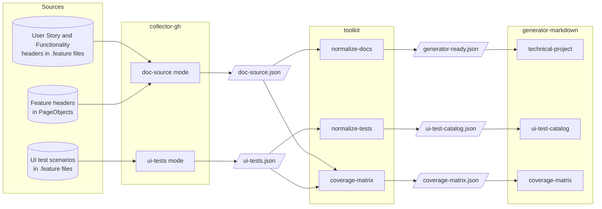

# Data flows

## Purpose

This page shows which component writes and which reads each file of the source-code pipeline, following
`living-doc-utilities`' [Pipeline rules](https://github.com/AbsaOSS/living-doc-utilities/blob/master/docs/contracts/pipeline-rules.md).
It names those rules and links them, and defines none.

Read before: [Architecture](../introduction/architecture.md) · Next: [Contracts](contracts.md)

## Contents

- [Flow](#flow)
- [Files](#files)
- [Commands](#commands)
- [Views](#views)
- [Pipeline rules](#pipeline-rules)
- [Example](#example)
- [Planned](#planned)

## Flow

`collector-gh` reads the repositories checked out earlier in the job; each later step reads the files an earlier one
wrote. The header and scenario formats are in [Authoring formats](authoring-formats.md). Planned sources and outputs
are not drawn ([Planned](#planned)).



## Files

Default paths are relative to the step's working directory. Where each step takes its path:
[`collector-gh` output layout](https://github.com/AbsaOSS/living-doc-collector-gh/blob/master/docs/action.md#output-layout),
[`toolkit` inputs](https://github.com/AbsaOSS/living-doc-toolkit/blob/master/docs/action.md#inputs),
[`generator-markdown` usage](https://github.com/AbsaOSS/living-doc-generator-markdown/blob/master/README.md#usage).

| File | Default path | Written by | Read by |
|---|---|---|---|
| `doc-source.json` | `output/collector-gh/doc-source/doc-source.json` | `collector-gh`, mode `doc-source` | `toolkit` `normalize-docs` and `coverage-matrix` |
| `ui-tests.json` | `output/collector-gh/ui-tests/ui-tests.json` | `collector-gh`, mode `ui-tests` | `toolkit` `normalize-tests` and `coverage-matrix` |
| `generator-ready.json` | none: the `toolkit` step's `output` names it | `toolkit` `normalize-docs` | `generator-markdown`, document type `technical-project` |
| `ui-test-catalog.json` | none: the `toolkit` step's `output` names it | `toolkit` `normalize-tests` | `generator-markdown`, document type `ui-test-catalog` |
| `coverage-matrix.json` | none: the `toolkit` step's `output` names it | `toolkit` `coverage-matrix` | `generator-markdown`, document type `coverage-matrix` |
| `<document-type>.md` and `<document-type>.run-report.json` | `output/generator-markdown/` | `generator-markdown` | people: commit or publish the document |

## Commands

The three `toolkit` commands, one step each, and the document type each one's file feeds
([`toolkit` commands](https://github.com/AbsaOSS/living-doc-toolkit/blob/master/docs/action.md#commands)):

| Command | Reads | Writes | Feeds `document-type` |
|---|---|---|---|
| `normalize-docs` | `doc-source.json` | `generator-ready.json` | `technical-project` |
| `normalize-tests` | `ui-tests.json` | `ui-test-catalog.json` | `ui-test-catalog` |
| `coverage-matrix` | `doc-source.json` and `ui-tests.json` | `coverage-matrix.json` | `coverage-matrix` |

What each document shows: [Living Documentation Document Types](../guides/living-doc-document-types.md).

## Views

- The view is chosen at the `toolkit` step: `normalize-docs` and `coverage-matrix` take `view`, `inner` (the default)
  or `release` ([`toolkit` inputs](https://github.com/AbsaOSS/living-doc-toolkit/blob/master/docs/action.md#inputs)).
- `normalize-tests` takes none: a test catalog has no field that differs by view
  ([normalize-tests](https://github.com/AbsaOSS/living-doc-toolkit/blob/master/packages/services/normalize_tests/README.md)).
- The file records its view in `document.view`; `generator-markdown` renders that view and has no view input.
- One step writes one view: a pipeline that publishes both runs the command twice, to two `output` paths.
- What each view shows and drops: [Rendering rules — Views](rendering-rules.md#views).

## Pipeline rules

Three `living-doc-utilities` rules bind every pipeline. This page names them; each link defines one.

- [One project, one pipeline, one documentation source](https://github.com/AbsaOSS/living-doc-utilities/blob/master/docs/contracts/pipeline-rules.md#one-project-one-pipeline-one-documentation-source):
  what one run documents and which files it reads.
- [Project id](https://github.com/AbsaOSS/living-doc-utilities/blob/master/docs/contracts/pipeline-rules.md#project-id):
  the `project-id` input that names the project a run documents.
- [Collector output layout](https://github.com/AbsaOSS/living-doc-utilities/blob/master/docs/contracts/pipeline-rules.md#collector-output-layout):
  where a collector writes and what it clears.

## Example

One job's steps: collect the documentation, normalize it in the release view, render the technical project. Each
action is pinned by its release tag, and one `project-id` names the project.

```yaml
- uses: actions/checkout@v7
- uses: actions/setup-python@v7
  with: { python-version: '3.14' }
- uses: AbsaOSS/living-doc-collector-gh@v0.2.0
  with:
    project-id: your-project
    doc-source: true
    doc-source-repositories: |
      [{"organization-name": "your-org", "repository-name": "your-repo",
        "us-paths": ["${{ github.workspace }}/features"]}]
- uses: AbsaOSS/living-doc-toolkit@v0.1.0
  with:
    command: normalize-docs
    input: output/collector-gh/doc-source/doc-source.json
    output: output/toolkit/generator-ready.json
    view: release
- uses: AbsaOSS/living-doc-generator-markdown@v0.1.0
  with:
    document-type: technical-project
    source-path: output/toolkit/generator-ready.json
```

The document lands in `output/generator-markdown/technical-project.md`. Every input of each step:
[`collector-gh`](https://github.com/AbsaOSS/living-doc-collector-gh/blob/master/docs/action.md#inputs),
[`toolkit`](https://github.com/AbsaOSS/living-doc-toolkit/blob/master/docs/action.md#inputs),
[`generator-markdown`](https://github.com/AbsaOSS/living-doc-generator-markdown/blob/master/README.md#usage).

## Planned

- **GitHub issues** (planned): `collector-gh`'s `doc-issues` mode, writing `doc-entities.json`
  ([Documentation Issues](https://github.com/AbsaOSS/living-doc-collector-gh/blob/master/doc_issues/README.md)).
- **Azure DevOps work items** (planned): `living-doc-collector-ad`, writing `doc-entities.json`
  ([collector-ad](../projects/collector-ad.md)).
- **PDF** (planned): `living-doc-generator-pdf`, rendering the same three `toolkit` files
  ([generator-pdf](../projects/generator-pdf.md)).
