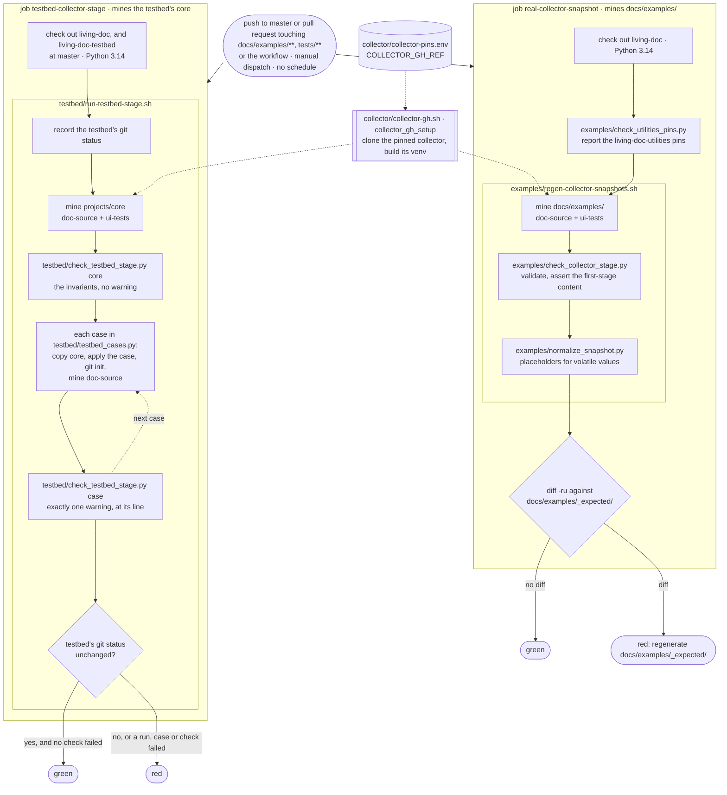

# Tests

## Purpose

This page is for contributors who run, debug or extend the checks here: the static check of
`docs/examples/`, and the two stages that mine with the pinned `living-doc-collector-gh`.

Read before: [CONTRIBUTING.md § Regenerating the collector snapshots](../CONTRIBUTING.md#regenerating-the-collector-snapshots)
and [§ The collector stage over the testbed](../CONTRIBUTING.md#the-collector-stage-over-the-testbed).
Next: [Negative testbed cases](testbed/negative-cases.md).

## Contents

- [Stages](#stages)
- [The workflow](#the-workflow)
- [Layout](#layout)
- [The testbed stage](#the-testbed-stage)
- [What a testbed run does](#what-a-testbed-run-does)
- [What the testbed checks assert](#what-the-testbed-checks-assert)
- [Run the testbed stage](#run-the-testbed-stage)
- [Read a testbed failure](#read-a-testbed-failure)

## Stages

| Stage | Workflow · job | Reads | Asserts |
|---|---|---|---|
| static | `examples-check.yml` · `examples-check` | `docs/examples/`, without a collector | the corpus's grammar and cross-references |
| snapshot | `real-collector.yml` · `real-collector-snapshot` | `docs/examples/`, mined | the corpus's first-stage content, then no diff against `docs/examples/_expected/` |
| testbed | `real-collector.yml` · `testbed-collector-stage` | the testbed's `core`, mined | invariants, then exactly one warning per derived case |

- The snapshot and testbed stages share one collector and one venv.
- Static rules: the module docstring of [`examples/examples_check.py`](examples/examples_check.py).
- Snapshot procedure (regenerate, commit, bump the pin):
  [CONTRIBUTING.md § Regenerating the collector snapshots](../CONTRIBUTING.md#regenerating-the-collector-snapshots).
- From [The testbed stage](#the-testbed-stage) on, this page covers the testbed stage only.

## The workflow

[`real-collector.yml`](../.github/workflows/real-collector.yml) runs both collector stages as two
independent jobs on one pinned collector. Either job failing fails the run; a new push to the same
ref cancels the run in progress.



Only each job's last decision is drawn; in the snapshot job, any earlier red step stops the job.
Testbed failure handling: [What a testbed run does](#what-a-testbed-run-does).
Case steps: [Negative testbed cases](testbed/negative-cases.md).

## Layout

One folder per subject: `collector/` (shared by both collector stages), `examples/` (tests
`docs/examples/`), `testbed/` (tests the testbed).

| File | Stage | Holds |
|---|---|---|
| [`collector/collector-gh.sh`](collector/collector-gh.sh) | snapshot, testbed | the pinned collector, its venv and its run; both runners source it |
| [`collector/collector-pins.env`](collector/collector-pins.env) | snapshot, testbed | the collector pin, `COLLECTOR_GH_REF` |
| [`examples/examples_check.py`](examples/examples_check.py) | static | the corpus checker |
| [`examples/test_examples_check.py`](examples/test_examples_check.py) | static | the corpus checker's tests |
| [`examples/requirements-examples-check.txt`](examples/requirements-examples-check.txt) | static | the corpus checker's pinned requirements, `living-doc-utilities` among them |
| [`examples/check_utilities_pins.py`](examples/check_utilities_pins.py) | snapshot | the `living-doc-utilities` pin report, collector vs. corpus checker; the CI job's first step |
| [`examples/test_check_utilities_pins.py`](examples/test_check_utilities_pins.py) | — | the pin report's tests; run by `examples-check.yml`, which has `pytest` |
| [`examples/regen-collector-snapshots.sh`](examples/regen-collector-snapshots.sh) | snapshot | the runner; writes `docs/examples/_expected/` or a directory to diff against it |
| [`examples/check_collector_stage.py`](examples/check_collector_stage.py) | snapshot | the corpus's first-stage content |
| [`examples/normalize_snapshot.py`](examples/normalize_snapshot.py) | snapshot | replaces volatile values with placeholders before the diff |
| [`testbed/run-testbed-stage.sh`](testbed/run-testbed-stage.sh) | testbed | the runner, and the testbed's collector paths and `project-id` |
| [`testbed/testbed_cases.py`](testbed/testbed_cases.py) | testbed | the derived problem cases, one function each |
| [`testbed/check_testbed_stage.py`](testbed/check_testbed_stage.py) | testbed | the invariants over `core`, and the check for one case |
| [`testbed/negative-cases.md`](testbed/negative-cases.md) | testbed | those cases: each one, how its run is checked, how to add one |

## The testbed stage

Reads the `core` project of [`AbsaOSS/living-doc-testbed`](https://github.com/AbsaOSS/living-doc-testbed)
at `master`.

- `core` follows the canon 100 %: any warning over it is a defect.
- Nothing about `core`'s content is written here; every count comes from the checkout at run time.
- Problems the pipeline must report are [negative cases](testbed/negative-cases.md).
- The stage only reads the testbed, and fails if the checkout changes.

## What a testbed run does

1. Clones the pinned collector and builds or reuses its venv → `collector-gh.sh::collector_gh_setup`.
2. Shallow-clones the testbed's `master`, or reads the checkout passed as the first argument.
3. Records the checkout's full `git status`, ignored and untracked files included → `run-testbed-stage.sh::testbed_status`.
4. Mines `projects/core` with `doc-source` and `ui-tests` → `run-testbed-stage.sh::mine`.
5. Asserts the invariants over that output → `testbed/check_testbed_stage.py::check_core`.
6. For each case: copies `core`, applies the case, makes the copy a git checkout, mines it with
   `doc-source` only, and asserts the one expected warning → `testbed/check_testbed_stage.py::check_case`.
   The details: [Negative testbed cases § How a case run is checked](testbed/negative-cases.md#how-a-case-run-is-checked).
7. Fails if the testbed's `git status` differs from step 3.

- A failed collector run, case or check marks the stage failed; the stage moves on to the next.
- A failed setup step (listing the cases, copying `core`, making the git checkout) stops it at once.
- All output goes to a temp work dir, deleted on exit.

## What the testbed checks assert

Full list: the module docstring of [`testbed/check_testbed_stage.py`](testbed/check_testbed_stage.py).
Where each part is checked:

- Every artifact validates against its contract; `sources_failed` is 0 → `check_testbed_stage.py::_read`.
- No warning at all, in either artifact → `check_testbed_stage.py::check_core`.
- Entities, their ACs, Feature states, pages, AC variants, no entity from a file outside the living-doc
  folders → `check_testbed_stage.py::check_doc_source`.
- Scenarios, AC links, tag parameters, no AC link from a file outside the living-doc folders
  → `check_testbed_stage.py::check_ui_tests`.
- `core` holds at least one of each construct, so no check passes on nothing → `check_testbed_stage.py::check_core`.
- A case run's one warning → `check_testbed_stage.py::check_case`.

## Run the testbed stage

From the repository root (the script runs from any directory):

```shell
tests/testbed/run-testbed-stage.sh                         # shallow-clones the testbed's master
tests/testbed/run-testbed-stage.sh ../living-doc-testbed   # reads a checkout you already have
```

- Needs bash 3.2+ (Linux, macOS, or Git Bash on Windows), `git` and access to github.com.
- Python, the venv and the token-free run: as for the snapshot stage, see
  [CONTRIBUTING.md § Regenerating the collector snapshots](../CONTRIBUTING.md#regenerating-the-collector-snapshots).
- Environment variables:
  - `PYTHON` — the interpreter the collector's venv is built from.
  - `GITHUB_STEP_SUMMARY` — set in CI; the testbed SHA and each check's output are appended to it.
- In CI, a testbed merge triggers nothing; dispatch the workflow by hand to read a new testbed `master`.
- Apply or add a case: [Negative testbed cases](testbed/negative-cases.md).

## Read a testbed failure

| Output | Meaning | Fix in |
|---|---|---|
| `FAIL doc-source: …` or `FAIL ui-tests: …` under `testbed core: N invariant(s) failed` | the collector mined `core` wrongly, or `core` left the canon | the collector or `living-doc-utilities` (an issue there); or the testbed |
| `nothing to assert: the checkout has no …` | `core` no longer holds a construct a check needs | the testbed, or the check here if the construct was dropped on purpose |
| `ERROR: case … could not be applied` | the case found no target in `core` | the case here |
| `FAIL doc-source: expected exactly one warning, …` | a case run reported other warnings, or none | the case here, or the collector |
| `ERROR: the collector failed over …` | the collector exited non-zero | the collector, or the pin in `collector/collector-pins.env` |
| `ERROR: the stage changed the testbed checkout …` | something wrote into the testbed | the runner or the collector's output paths |

A check or case here can also stop fitting a valid `core`: fix the check or case, never the testbed.
